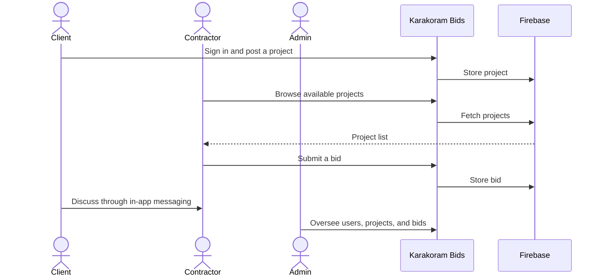
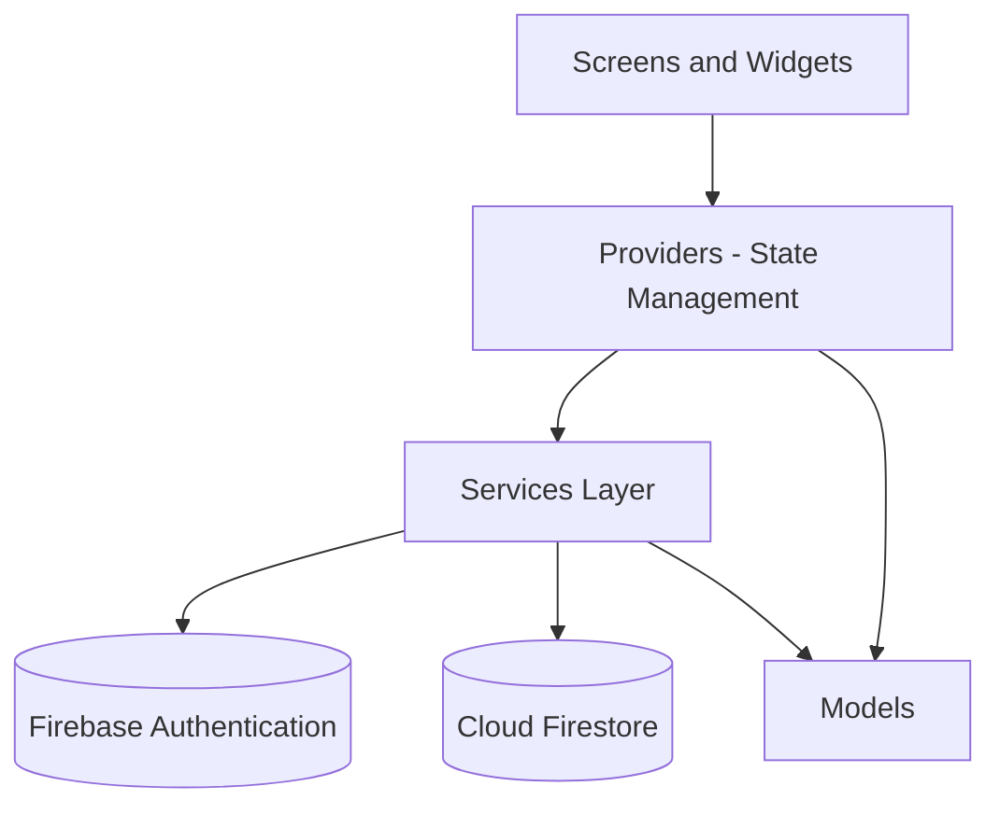

<div align="center">

# 🏗️ Karakoram Bids

### Construction Project & Bidding Platform

**Connecting clients and contractors through one mobile app.**

Built with Flutter and Firebase as a Final Year Project at Karakoram International University.

<br>


<br>

[**About**](#-about-the-project) ·
[**Features**](#-features) ·
[**Architecture**](#-architecture) ·
[**Getting Started**](#-getting-started) ·
[**Team**](#-team)

</div>

---

## 📖 Table of Contents

<details>
<summary>Click to expand</summary>

- [About the Project](#-about-the-project)
- [Highlights](#-highlights)
- [Screenshots](#-screenshots)
- [Features](#-features)
- [How It Works](#-how-it-works)
- [Architecture](#-architecture)
- [Tech Stack](#-tech-stack)
- [Project Structure](#-project-structure)
- [Getting Started](#-getting-started)
- [Firebase Setup](#-firebase-setup)
- [Troubleshooting](#-troubleshooting)
- [Security](#-security)
- [Roadmap](#-roadmap)
- [Team](#-team)
- [Acknowledgements](#-acknowledgements)
- [License](#-license)

</details>

---

## 📌 About the Project

Construction projects are often coordinated through scattered channels: word of mouth, phone calls, and informal messaging. This makes it hard for clients to find suitable contractors, and hard for contractors to discover work.

**Karakoram Bids** brings this process into one mobile application. Clients publish construction projects, contractors browse them and submit bids, and administrators oversee users, projects, and bids. Authentication, cloud data storage, and in-app messaging are built on Firebase.

| | |
| --- | --- |
| **Degree** | BS Computer Science |
| **Institution** | Karakoram International University |
| **Supervisor** | Mr. Sajid Hussain |
| **Category** | Final Year Project (FYP) |
| **Application type** | Cross-platform mobile application |
| **Team size** | 2 members |

---

## 🌟 Highlights

- 🔀 **Three user roles** with separate interfaces: Client, Contractor, and Administrator
- ☁️ **Cloud-backed** with Firebase Authentication and Cloud Firestore
- 💬 **Built-in messaging** between users
- 🧱 **Layered architecture** separating UI, state, and data access
- 🎨 **Centralized theme** and reusable widgets for a consistent interface
- 📶 **Connectivity monitoring** for a smoother experience on unstable networks

---

## 📱 Screenshots

<!--
Screenshots add karne ke baad is comment ko hata do.
Images ko `docs/screenshots/` folder mein rakho (ya paths badal do).

<table>
  <tr>
    <td align="center"><br><sub><b>Login</b></sub></td>
    <td align="center"><br><sub><b>Client Dashboard</b></sub></td>
    <td align="center"><br><sub><b>Project Listings</b></sub></td>
    <td align="center"><br><sub><b>Submit Bid</b></sub></td>
  </tr>
  <tr>
    <td align="center"><br><sub><b>Messaging</b></sub></td>
    <td align="center"><br><sub><b>Profile</b></sub></td>
    <td align="center"><br><sub><b>Admin Panel</b></sub></td>
    <td align="center"><br><sub><b>Contractor Dashboard</b></sub></td>
  </tr>
</table>
-->

*Screenshots coming soon.*

<!--
Agar APK ya demo video hai to yahan add karo:

### 📥 Download
[⬇️ Download APK](https://github.com/syedazfar313/my_karakoram_bids/releases)

### 🎥 Demo
[▶️ Watch the demo](YOUR_VIDEO_LINK)
-->

---

## ✨ Features

### 👤 Client
- Register and sign in securely
- Post and manage construction projects
- Browse contractor profiles
- Message contractors directly

### 👷 Contractor
- Browse available construction projects
- View full project details
- Submit and manage bids
- Maintain a contractor profile

### 🛡️ Administrator
- Manage users
- Manage projects
- Manage bids

### 🔧 Platform
- Firebase Authentication with password recovery and password change
- Cloud Firestore for data storage and messaging
- Profile image selection
- Network connectivity monitoring
- Form validation and error handling throughout
- Reusable UI components and a centralized app theme

### 🔍 Roles at a Glance

| Capability | Client | Contractor | Admin |
| --- | :---: | :---: | :---: |
| Register / sign in | ✅ | ✅ | ✅ |
| Post projects | ✅ | | |
| Browse projects | ✅ | ✅ | ✅ |
| Submit bids | | ✅ | |
| Messaging | ✅ | ✅ | |
| Manage users, projects, bids | | | ✅ |

---

## 🔄 How It Works



---

## 🏛️ Architecture

The app follows a layered structure that separates UI, state, and data access. Screens never talk to Firebase directly. They go through providers and services, which keeps the UI easy to change and the logic easy to test.



| Layer | Responsibility |
| --- | --- |
| **Presentation** | Screens and reusable widgets, grouped by user role |
| **State** | `Provider` for app and session state |
| **Services** | Authentication, messaging, connectivity |
| **Models** | Typed data classes for application entities |
| **Core** | Theme, utilities, shared widgets |

### Core Entities

| Entity | Description |
| --- | --- |
| **User** | Account and profile for clients, contractors, and admins |
| **Project** | A construction project posted by a client |
| **Bid** | A contractor's offer on a project |
| **Message** | Conversation data between users |

---

## 🧰 Tech Stack

| Technology | Purpose |
| --- | --- |
| **Flutter** | Cross-platform UI framework |
| **Dart** | Programming language |
| **Firebase Authentication** | User sign-in and account management |
| **Cloud Firestore** | NoSQL cloud database |
| **Provider** | State management |
| **Image Picker** | Profile image selection |
| **Material Design** | UI components |
| **Git and GitHub** | Version control |

---

## 🗂️ Project Structure

```text
my_karakoram_bids/
├── lib/
│   ├── core/
│   │   ├── services/       # Auth, messaging, connectivity
│   │   ├── theme/          # App theme and styling
│   │   ├── utils/          # Helpers and validators
│   │   └── widgets/        # Shared UI components
│   ├── models/             # Data models
│   ├── providers/          # State management
│   ├── routes/             # Navigation
│   ├── screens/
│   │   ├── admin/
│   │   ├── auth/
│   │   ├── client/
│   │   ├── common/
│   │   ├── contractor/
│   │   └── splash/
│   ├── widgets/
│   └── main.dart
├── test/
├── pubspec.yaml
└── README.md
```

---

## 🚀 Getting Started

### Prerequisites

- [Flutter SDK](https://docs.flutter.dev/get-started/install)
- Android Studio or VS Code with the Flutter extension
- An Android emulator or a physical device
- A Firebase project (see [Firebase Setup](#-firebase-setup))

### Installation

```bash
# 1. Clone the repository
git clone https://github.com/syedazfar313/my_karakoram_bids.git

# 2. Move into the project
cd my_karakoram_bids

# 3. Install dependencies
flutter pub get

# 4. Verify your environment
flutter doctor

# 5. Run the app
flutter run
```

### Useful Commands

```bash
flutter analyze        # Static analysis
flutter test           # Run tests
flutter clean          # Clear build cache
flutter build apk      # Build a release APK
```

---

## 🔥 Firebase Setup

The app needs its own Firebase project. Firebase configuration files are not meant to be shared publicly, so set up your own:

1. Create a project in the [Firebase Console](https://console.firebase.google.com/).
2. Register your Android and/or iOS app.
3. Run `flutterfire configure` to generate the configuration.
4. Enable **Email/Password** sign-in under Authentication.
5. Create a **Cloud Firestore** database.
6. Apply Firestore security rules before using the app with real data.

Reference documentation:
[FlutterFire](https://firebase.google.com/docs/flutter/setup) ·
[Authentication](https://firebase.google.com/docs/auth) ·
[Cloud Firestore](https://firebase.google.com/docs/firestore)

---

## 🩺 Troubleshooting

| Problem | Fix |
| --- | --- |
| `flutter doctor` shows issues | Follow its suggestions, then run it again |
| Dependency errors after pulling changes | Run `flutter clean` then `flutter pub get` |
| Firebase initialization error | Make sure `flutterfire configure` was run for your project |
| Sign-in fails | Check that Email/Password is enabled in Firebase Authentication |
| Data not loading | Check your Firestore rules and your internet connection |

---

## 🔒 Security

- Role-based access is enforced through Firebase security rules.
- User input is validated before it is stored.
- API keys, service-account files, and credentials must never be committed to the repository.
- Authentication and authorization should be tested for every user role before release.

---

## 🗺️ Roadmap

- [ ] Push notifications for bid and project updates
- [ ] Advanced search and filtering
- [ ] Contractor ratings and reviews
- [ ] Project progress tracking
- [ ] Reporting and analytics for administrators
- [ ] Wider automated test coverage
- [ ] Accessibility improvements
- [ ] Performance optimization

---

## 👥 Team

This project was built by a two-member team.

<table>
  <tr>
    <td align="center" width="50%">
      <a href="https://github.com/syedazfar313">
        <br>
        <b>Syed Azfar Abbas</b>
      </a><br>
      <sub>👑 Team Leader</sub><br><br>
      Backend development<br>
      Database design and integration<br>
      FYP report<br>
      Final presentation
    </td>
    <td align="center" width="50%">
      <a href="https://github.com/syedmahnoor026">
        <br>
        <b>Mahnoor Syed</b>
      </a><br>
      <sub>👩‍💻 Team Member</sub><br><br>
      Project proposal<br>
      UX/UI design<br>
      Frontend development
    </td>
  </tr>
</table>

---

## 🙏 Acknowledgements

Thanks to our supervisor, **Mr. Sajid Hussain**, for his guidance throughout the project, and to the faculty of the Department of Computer Science at **Karakoram International University**.

---

## 📄 License

This project was developed for academic purposes as a Final Year Project. All rights are reserved by the authors unless a license is added to this repository.

---

<div align="center">

**Karakoram Bids**<br>
<sub>Built by Syed Azfar Abbas and Mahnoor Syed · Karakoram International University</sub>

<br>

⭐ If you found this project interesting, consider giving it a star.

</div>
